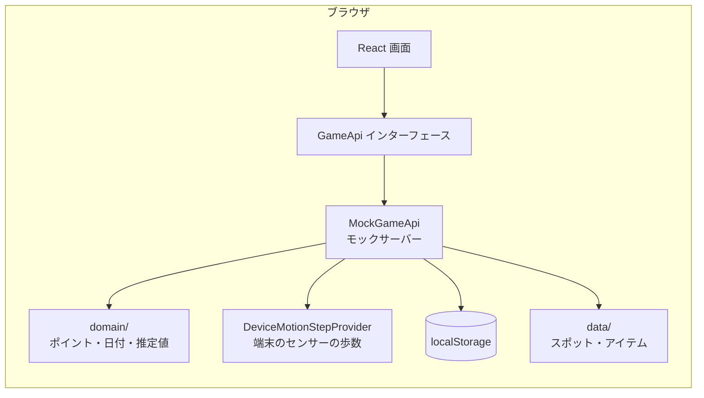
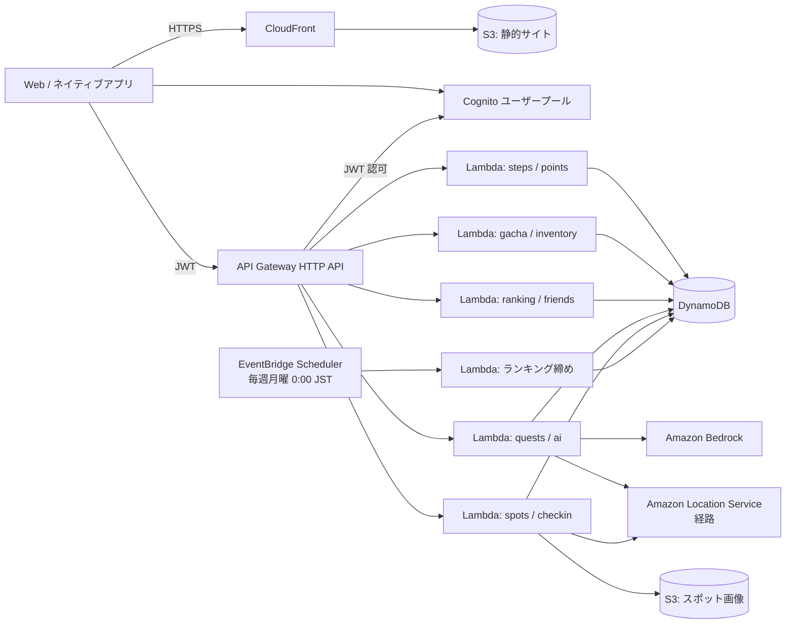
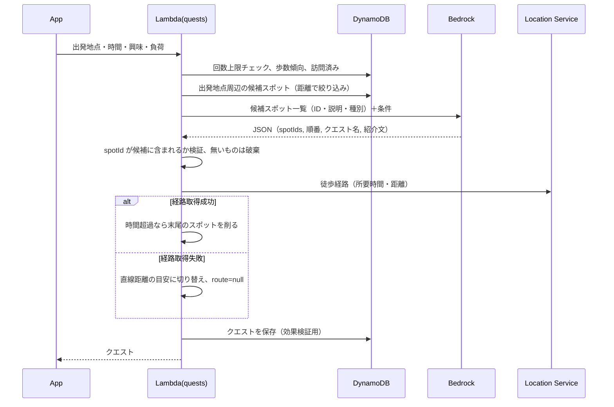

# 設計書：えひめウォーククエスト

要件は [requirements.md](./requirements.md)、実装順序は [tasks.md](./tasks.md) を参照。

## 1. 全体方針

- **まず Web アプリとして動かす。** 歩数取得部分は「歩数プロバイダー」として差し替え可能にし、後から iOS / Android のネイティブアプリ（Capacitor などでラップ）で HealthKit / Health Connect を接続する。
- **フロントエンドは API インターフェース越しにデータを扱う。** フェーズ1 はブラウザ内のモックサーバー（`MockGameApi`）、フェーズ2 以降は API Gateway + Lambda（`HttpGameApi`）に切り替える。画面のコードは変えない。
- **ゲーム規則は純粋関数に分ける。** `frontend/src/domain/` のポイント計算・日付計算などは副作用を持たず、フェーズ2 で `shared/` パッケージへ移して Lambda と共有する。
- **AI は登録データに基づいて提案する。** スポットはデータベースから選ばせ、経路と所要時間は経路検索サービスで計算する。

## 2. システム構成

### 2.1 フェーズ1（MVP・現在）



### 2.2 フェーズ2 以降（AWS）



| 区分 | サービス | 用途 | 備考 |
|---|---|---|---|
| 配信 | S3 + CloudFront | フロントエンドの配信 | SPA のため 404 を `index.html` に返す設定 |
| 認証 | Cognito ユーザープール | ログイン、JWT 発行 | API Gateway の JWT オーソライザーで検証 |
| API | API Gateway（HTTP API） | REST API | ルート単位のスロットリング |
| 処理 | Lambda（Node.js 22 以上、TypeScript） | ゲーム処理、AI 呼び出し | 機能ごとに関数を分ける |
| DB | DynamoDB（オンデマンド） | ユーザーデータ、マスタ | 6 章参照 |
| AI | Bedrock | クエスト・ミッション・ガイド生成 | モデル ID は環境変数で指定 |
| 地図表示 | MapLibre GL JS + ベクトル地図（地理院の最適化ベクトルタイル、または OpenStreetMap ベースの OpenFreeMap） | 観光マップ・現在地・スポットの表示 | 2026-11-12 チームで決定。API キー不要・無料。各提供元の出典表示と利用規約に従う |
| 経路 | Amazon Location Service | 徒歩経路計算 | 利用可否を要確認。不可なら利用規約に適合する別サービス |
| 定期実行 | EventBridge Scheduler | 週間ランキングの締め | タイムゾーン `Asia/Tokyo` |
| 画像 | S3 | スポット写真、アイテム画像 | CloudFront 経由で配信 |
| 監視 | CloudWatch、AWS Budgets | ログ、予算アラート | |

> **前提の確認が必要：** 愛媛県が提供する AWS 環境で使えるサービス・リージョン・権限（特に Bedrock のモデルアクセス、Amazon Location Service、Cognito、IaC の実行権限）は未確認。フェーズ2 着手前に確認する（tasks.md の 2.0）。

## 3. フォルダ構成

```
EhimeWalk/
├─ .kiro/specs/ehime-walk-quest/   要件・設計・タスク
├─ docs/
│  └─ evidence.md                  根拠資料の記録（出典・URL・確認日）
├─ frontend/                       React + TypeScript + Vite + Tailwind CSS
│  ├─ public/                      favicon など
│  └─ src/
│     ├─ api/                      GameApi インターフェースと実装
│     │  ├─ types.ts               API の型
│     │  ├─ mockApi.ts             モックサーバー（localStorage）
│     │  ├─ stepProviders/         歩数プロバイダー（demo / 将来 healthkit 等）
│     │  └─ index.ts               環境変数で実装を選ぶ
│     ├─ domain/                   純粋関数のゲーム規則（将来 shared/ へ移動）
│     │  ├─ date.ts                JST の日付計算
│     │  ├─ points.ts              ポイント計算
│     │  ├─ health.ts              距離・カロリーの推定
│     │  ├─ steps.ts               歩数の集計
│     │  ├─ geo.ts                 2 点間の距離
│     │  └─ types.ts               ドメインの型
│     ├─ data/                     マスタデータ（スポット・アイテム）
│     ├─ features/                 機能単位の部品
│     │  ├─ character/             ドット絵キャラクター（レイヤー描画）
│     │  ├─ steps/                 歩数ダッシュボード
│     │  └─ quests/                クエスト表示
│     ├─ components/               共通 UI（レイアウト、ナビ、カード）
│     ├─ hooks/                    データ取得フック
│     └─ pages/                    画面
├─ shared/                         （フェーズ2）domain/ を移し Lambda と共有
├─ backend/                        （フェーズ2）Lambda ハンドラー
└─ infra/                          （フェーズ2）IaC（AWS CDK を想定、権限次第で SAM / 手動）
```

## 4. フロントエンド設計

### 4.1 技術スタック

| 用途 | ライブラリ | 理由 |
|---|---|---|
| UI | React 19 + TypeScript | 指定どおり |
| ビルド | Vite 8 | 指定どおり |
| スタイル | Tailwind CSS 4（`@tailwindcss/vite`） | 指定どおり。テーマ色を `@theme` で定義 |
| ルーティング | React Router 8（宣言的モード） | 5 画面の切り替え |
| グラフ | 自作（CSS の棒グラフ） | 7 日分の棒グラフだけなので依存を増やさない |
| ドット絵 | 自作 SVG レンダラー | 文字列のピクセルマップを `<rect>` に変換。画像ファイル不要で着せ替えの色替えが容易 |

### 4.2 画面構成

| パス | 画面 | 主な内容 | フェーズ |
|---|---|---|---|
| `/` | ホーム | キャラクター、今日の歩数と目標、所持ポイント、AI おすすめクエスト、ガチャへの近道、健康ダッシュボード | 1 |
| `/adventure` | 冒険 | スポット一覧、AI 散策ルート生成、観光マップ、チェックイン、図鑑 | 1〜3 |
| `/gacha` | ガチャ・着せ替え | ガチャ演出、排出確率、所持アイテム、着せ替え、アイテム図鑑 | 1 |
| `/ranking` | ランキング | 全ユーザー / 愛媛県 / フレンドのタブ | 1〜2 |
| `/mypage` | マイページ | プロフィール、フレンド、歩数履歴、称号、訪問履歴、設定 | 1〜2 |
| `/welcome` | キャラクター作成 | 初回起動時のみ | 1 |

共通レイアウト：上部にアプリ名、モック動作中はその下に帯を表示する。画面幅によって次のように切り替える。

| 幅 | メニュー | 内容 |
|---|---|---|
| 〜767px（スマートフォン） | 下部固定ナビ | 1 列 |
| 768〜1023px（タブレット） | 下部固定ナビ | 2 列（ホーム・冒険・ガチャ・マイページ） |
| 1024px〜（パソコン） | 左側メニュー | 2 列、最大幅 1152px で中央寄せ |

### 4.3 デザイン

| 役割 | 色 | Tailwind 名 |
|---|---|---|
| 主色（愛媛のみかん） | `#F39800` 系 | `mikan-*` |
| 副色（瀬戸内海） | `#4CC3D9` 系 | `seto-*` |
| 健康・自然 | `#4CAF50` 系 | `leaf-*` |
| 背景 | 白・クリーム `#FFF8EE` | `cream` |
| 文字 | 濃い茶 `#3D2B1F` | `ink` |

- 見出しとゲーム的な数字にドット風フォント（DotGothic16）、本文は読みやすさを優先して OS 標準の日本語ゴシックを使う。
- カードは太めの枠線と角丸で、RPG のウィンドウ風にする。
- ルートの文字サイズを 17px にし、Tailwind の rem 単位を全体的に大きくする。

### 4.4 ドット絵キャラクター（レイヤー方式）

- キャンバスは 16 × 22 ピクセル。各レイヤーは「文字列の行配列 + パレット + 縦方向オフセット」で表す。
- `.` は透明、英字はパレットの色。外見の色（肌 `S`、髪 `H`/`h`、目 `E`）はキャラクターの外見設定からパレットに差し込む。
- 描画順：背景 → 体 → 顔 → 下半身 → 靴 → 上半身 → 髪 → 頭 → アクセサリー。ペットはキャラクターの横に別の SVG で描く。
- 横に連続する同色ピクセルを 1 つの `<rect>` にまとめて要素数を減らす。`shape-rendering="crispEdges"` でぼやけを防ぐ。
- 将来、デザイナーが描いた PNG を使う場合も、アイテムの `visual` を画像 URL に差し替えるだけでよい構造にする。

### 4.5 API インターフェース

```ts
interface GameApi {
  readonly mode: 'mock' | 'aws'
  getProfile(): Promise<UserProfile>
  getCharacter(): Promise<Character>
  syncSteps(): Promise<StepSyncResult>          // 歩数を同期し、ポイントを付与
  getStepRecords(from, to): Promise<StepRecord[]>
  getPointBalance(): Promise<PointBalance>
  getRecommendedQuest(): Promise<QuestSuggestion>
  // フェーズ1 後半：drawGacha, getInventory, equipItem, getRanking ...
}
```

- `VITE_API_MODE=mock`（既定）で `MockGameApi`、`aws` で `HttpGameApi`（フェーズ2 で実装）を使う。
- `MockGameApi` は約 200ms の遅延を入れ、読み込み表示とエラー表示を開発中に確認できるようにする。

### 4.6 歩数プロバイダー

```ts
interface StepDataProvider {
  readonly source: 'demo' | 'healthkit' | 'health_connect'
  isAvailable(): Promise<boolean>
  getDailySteps(from: DateKey, to: DateKey): Promise<DailySteps[]>
}
```

- `DeviceMotionStepProvider`：端末の加速度センサー（devicemotion）で、アプリを開いて計測している間に数えた歩数を日付ごとに端末へ保存し、同期で返す。はじめは 0 歩。アプリを開くと自動で計測を始め（iPhone はセンサーの利用許可を求める）、利用者が止めたら次に「はじめる」を押すまで止めたままにする。アプリを閉じている間は数えられない（Web の制限。HealthKit / Health Connect 連携で対応）。センサーの歩数は `pending`（検証待ち）とし、正式ランキングには入れない。デモ操作で足した歩数は `demoAddedSteps` として区別し `excluded` にする。
- 記録には `source` を必ず付け、サーバー側で `demo` を正式ランキングから除外する。

## 5. ゲーム規則

### 5.1 ポイント

| 規則 | 値 |
|---|---|
| 歩数ポイント | 100 歩 = 1 pt（端数切り捨て） |
| 1 日の上限 | なし（2026-11-12 廃止）。1 日 100,000 歩を超える記録は異常値として受け付けない |
| ガチャ 1 回 | 50 pt |
| ログインボーナス | 1 日 1 回 10 pt（仮） |

**二重付与の防止：** 日付ごとに「付与済みポイント」を記録し、同期のたびに `付与額 = max(0, その日の歩数ポイント − 付与済みポイント)` を付与する。DynamoDB では付与済み記録の更新と残高の加算を `TransactWriteItems` で 1 つにまとめ、条件式（`awarded = :expected`）で同時実行時の重複を防ぐ。

**デモ操作：** モック環境（公開版を含む）では、発表・動作確認のためにコインと歩数をデモ操作で追加でき、通常の規則でコインを付与する。本番の API（HttpGameApi）にはデモ操作の入口を作らない。

### 5.2 健康の推定値

| 項目 | 計算 | 前提 |
|---|---|---|
| 移動距離 | 歩数 × 歩幅 | 歩幅 0.7m（将来は身長 × 0.45 で個人設定） |
| 消費カロリー | METs × 体重(kg) × 時間(h) × 1.05 | 普通歩行 時速 4km = 3.0 METs、体重 60kg |
| 時間 | 距離 ÷ 時速 4km | |

画面には「推定値（体重 60kg・時速 4km で概算）」と表示する。

### 5.3 歩数目標

- 初期値は 1 日 6,000 歩。健康日本21（第三次）の目標値は 20〜64 歳 8,000 歩、65 歳以上 6,000 歩であり、初めての利用者でも達成しやすい値から始める（出典は `docs/evidence.md`）。
- AI 健康ミッション（フェーズ2）は、過去 7 日平均の +10%（最大 +1,000 歩）を上限に提案する。平均 8,000 歩以上なら維持を提案する。

### 5.4 ガチャ

- 排出率はマスタで管理し（初期値 N 60% / R 30% / SR 9% / SSR 1%）、画面に同じ値を表示する。レア度を決めた後、同じレア度の中から等確率で 1 つ選ぶ（`domain/gacha.ts`）。
- 持っているアイテムが出たときは所持数を増やさず、レア度に応じたコインに変換する（`data/items.ts` の `GACHA_DUPLICATE_COINS`、初期値 N 5・R 15・SR 30・SSR 50。取引理由 `gacha_refund`）。コイン消費と変換は 1 回の書き込みで保存する。
- 抽選はサーバー側の暗号論的乱数（`crypto.randomInt`）で行う。
- ポイント減算、アイテム追加、ガチャ履歴の記録を 1 トランザクションで行う。

## 6. データモデル

### 6.1 論理モデル

| エンティティ | 主な属性 |
|---|---|
| Users | userId, username, friendCode, selectedRegion, ehimeRankingOptIn, dailyGoal, title, createdAt |
| Characters | userId, name, appearance（hairStyle, hairColor, skinTone, eyeColor）, equipped（8 スロット） |
| Items（マスタ） | itemId, name, category, rarity, visual / imageUrl, acquisitionType, regionCode |
| UserItems | userId, itemId, quantity, firstAcquiredAt |
| StepRecords | userId, date, steps, source, syncTimestamp, verification（trusted / pending / excluded） |
| StepAwards | userId, date, awardedPoints |
| PointTransactions | transactionId, userId, amount, reason, refKey, createdAt |
| Friendships | userId, friendUserId, status（pending_sent / pending_received / accepted） |
| TouristSpots（マスタ） | spotId, name, prefectureCode, municipalityCode, latitude, longitude, checkinRadiusM, kind, tags, description, rewardItemId, nearbySpotIds, sources |
| Visits | userId, spotId, visitedAt, via（ai_quest / list / map）, questId |
| Quests | questId, userId, input, spotIds, routeSummary, createdAt, model |
| Rankings | period（週）, scope（all / pref#38 / muni#38201 / friends は都度計算）, userId, steps, rank |
| AnalyticsDaily | date, metric, value（個人を含まない集計値） |

### 6.2 DynamoDB テーブル設計

アクセスパターンに合わせて、ユーザーデータは 1 テーブル（`ewq-main`）にまとめ、マスタとランキングを分ける。

**`ewq-main`（PK / SK）**

| データ | PK | SK | 主なアクセス |
|---|---|---|---|
| プロフィール | `USER#{userId}` | `PROFILE` | 取得・更新 |
| キャラクター | `USER#{userId}` | `CHARACTER` | 取得・着せ替え |
| ポイント残高 | `USER#{userId}` | `BALANCE` | 原子的な加減算 |
| 所持アイテム | `USER#{userId}` | `ITEM#{itemId}` | 一覧（`begins_with`） |
| 歩数 | `USER#{userId}` | `STEP#{yyyy-mm-dd}` | 期間指定（`between`） |
| 歩数ポイント付与 | `USER#{userId}` | `AWARD#{yyyy-mm-dd}` | 二重付与防止の条件付き更新 |
| ポイント取引 | `USER#{userId}` | `TX#{ISO日時}#{id}` | 履歴（新しい順） |
| フレンド | `USER#{userId}` | `FRIEND#{friendUserId}` | 一覧・状態 |
| 訪問 | `USER#{userId}` | `VISIT#{spotId}` | 図鑑・重複防止 |
| AI 利用回数 | `USER#{userId}` | `AIQUOTA#{yyyy-mm-dd}` | 1 日の上限チェック（TTL で削除） |
| 週間歩数 | `USER#{userId}` | `WEEK#{週の月曜}` | 自分の週間合計 |
| フレンドコード | `FRIENDCODE#{code}` | `USER` | コード検索・一意性 |

- GSI1（週間ランキング）：`WEEK` 項目に `GSI1PK = RANK#{週の月曜}#{scope}`、`GSI1SK = {歩数を 0 埋め 9 桁}` を持たせ、降順で上位を取得する。信頼済み歩数だけを加算し、参加スコープごとに項目を分ける。
- フレンドランキングは、フレンド一覧（最大 100 人程度）の `WEEK` 項目を `BatchGetItem` で取得して並べ替える。

**`ewq-master`**：`REGION#{都道府県コード}` / `SPOT#{spotId}`、`ITEMS` / `ITEM#{itemId}`、`GACHA#{gachaId}` / `RATES`。GSI で市町コード別のスポット一覧を取得する。

**`ewq-ranking-history`**：`RANKHIST#{週}#{scope}` / `{順位 0 埋め}#{userId}`。月曜 0:00 JST の締めで書き込む。

## 7. API 設計（フェーズ2）

すべて `Authorization: Bearer <Cognito JWT>`。ユーザー ID は JWT の `sub` から取得し、リクエスト本文の値は使わない。

| メソッド | パス | 内容 |
|---|---|---|
| GET | `/me` | プロフィール・キャラクター・残高 |
| PUT | `/me/character` | 外見・装備の更新（所持チェック） |
| POST | `/steps/sync` | 歩数の同期（最大 7 日分）→ 検証 → ポイント付与 |
| GET | `/steps?from&to` | 歩数記録 |
| POST | `/bonus/login` | ログインボーナス |
| POST | `/gacha/{gachaId}/draw` | ガチャ |
| GET | `/inventory` | 所持アイテム |
| GET | `/rankings/{scope}?week` | ランキング |
| GET/POST/DELETE | `/friends...` | フレンド検索・申請・承認・解除・応援 |
| GET | `/spots?region&municipality` | スポット一覧 |
| POST | `/spots/{spotId}/checkin` | チェックイン（座標と精度を送り、サーバーで判定） |
| POST | `/quests/generate` | AI 散策クエスト |
| GET | `/missions/weekly` | AI 健康ミッション |
| GET | `/spots/{spotId}/guide` | AI 観光ガイド |

入力検証は zod などのスキーマで行い、範囲外の値（歩数が負、日付が未来など）は 400 を返す。

## 8. AI 設計

### 8.1 散策クエスト生成の流れ



- **候補の事前絞り込み：** AI に渡す前に、サーバーが出発地点からの直線距離と希望時間でスポットを絞る。AI はその中から選び、順番と紹介文を作るだけにする。
- **出力形式：** Bedrock の Converse API でツール（JSON スキーマ）を指定し、構造化された出力を得る。
- **ハルシネーション対策：** 経路・時間・距離は AI に作らせない。紹介文には登録済みの説明だけを渡し、「渡した情報以外を断定しない」と指示する。
- **回数制限とキャッシュ：** 1 人 1 日 10 回（仮）。同じ条件の結果は 10 分間キャッシュする。
- **モデル：** 低価格・低遅延のモデルを優先し、モデル ID は環境変数で切り替える。利用可能なモデルは県の環境で確認する。

### 8.2 モック（フェーズ1）

- 登録スポットから、ユーザーの過去 7 日平均歩数に合わせて 1〜2 か所を選ぶ。
- 推定歩数は「直線距離 × 1.3 ÷ 歩幅」で出し、「直線距離からの目安」と表示する。
- カードに「AI提案（モック）」と表示する。

## 9. 不正対策（フェーズ4）

| 確認項目 | 判定 | 処理 |
|---|---|---|
| 歩数ソース | `demo` | ランキング除外（ポイントは本番では付与しない） |
| 手入力の記録 | HealthKit の `HKMetadataKeyWasUserEntered` 等 | 信頼済み歩数から除く |
| 1 日の歩数 | 60,000 歩超 | 保留 |
| 増加速度 | 前回同期からの増加 ÷ 経過時間 が 1 時間あたり 15,000 歩超 | 保留 |
| 日付 | 未来日、または 7 日より前 | 拒否 |
| 同期頻度 | 1 分に 1 回まで | 429 を返す |

しきい値は仮の値で、実データを見て調整する。保留は管理画面（将来）で確認する。端末を振るなどの物理的な水増しは防げないため、要件 10.5 のとおり保証範囲を明示する。

## 10. セキュリティ

- 秘密情報は AWS Secrets Manager / SSM パラメータストアに置く。`.env` はコミットしない（`.env.example` だけ置く）。
- Lambda の IAM ロールは関数ごとに最小権限（自分のテーブルの必要な操作、Bedrock の特定モデルの `InvokeModel` のみ）。
- 位置情報はチェックイン判定にだけ使い、生の座標は保存しない。ログにも出さない。
- CORS は配信元ドメインだけ許可する。

## 11. 効果検証

- 主要な操作（アプリ起動、目標達成、クエスト生成、クエスト経由の訪問、一覧経由の訪問、チェックイン）をイベントとして記録し、日次で `AnalyticsDaily` に集計する。
- 集計値だけを出力し、人数が 5 人未満の区分は表示しない。
- デモデータとテストユーザーは集計から除外する。
- 計測していない指標は「未計測」と表示する。

## 12. 他地域への展開

- 地域は全国地方公共団体コード（愛媛県 = 38、松山市 = 38201 など）で表す。
- スポット、地域限定アイテム、ランキングのスコープはすべてデータで定義し、コードを変えずに他県のデータを追加できるようにする。
